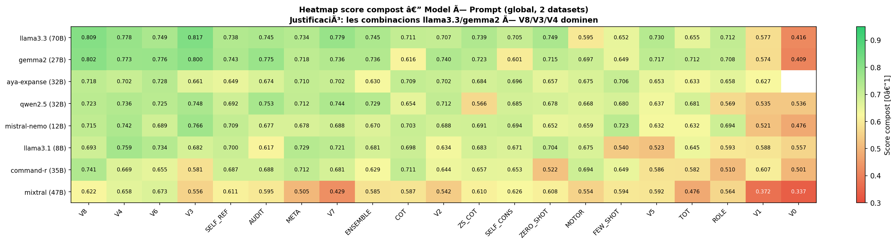

# Easy Read adaptation with local LLMs

Evaluation framework for automatically adapting Spanish texts to **Easy Read** (*Lectura Fácil*, standard **UNE 153101:2018**) using open-weight language models running fully locally with [Ollama](https://ollama.com). No external APIs and no data sent to third parties.

Bachelor's thesis (TFG) in Telecommunications Engineering, Universitat Rovira i Virgili, 2026. Grade: 9.4/10.

> Detailed reports, methodology and discussion are in Spanish in [`docs/`](docs/).

## Key results

| | |
|---|---|
| Models evaluated | 8 local LLMs, 8B–70B parameters |
| Prompting techniques | 20 (10 standard + 8 own iterative versions + 2 domain-specific) |
| Reference texts | 23, across two datasets with human Easy Read references |
| Automatic evaluations | **3,666** |
| Temperature study | 32 configurations (2 models × 2 prompts × 4 temperatures × 2 datasets) |
| Best SARI | **0.557** average for the V8 technique; **0.586** with `gemma2:27b` + V8 |

Main findings:

1. **Prompt design matters more than model size.** On administrative texts, `llama3.1:8b` with V8 ranks 6th out of 160 model × prompt combinations, ahead of most 30–70B configurations.
2. **V8 (progressive imitation)**, a technique developed in this project, ranks first on administrative texts on SARI, BERTScore and Levenshtein similarity.
3. **No technique wins in every domain.** V8 specialises in administrative text, while Chain-of-Thought generalises better across domains (inter-dataset gap of 0.04 vs 0.31).
4. **Temperature does not help.** SARI and BERTScore peak at `T=0.0` on both datasets, and higher temperatures increase domain specialisation.
5. **Recommended configuration:** `llama3.3` + `T=0.0` + V8 for administrative documents, or CoT for mixed-domain input.



## How it works

```
Excel dataset ──► run_general.py ──► Ollama (local LLM) ──► outputs/{task}/{model}/
  (original text,     │  task = prompt technique            (JSONL + Excel)
   human reference)   │  model = MODEL_REGISTRY entry              │
                      ▼                                            ▼
              prompts/*.txt                          evaluation/ ──► 7 metrics + combined score
                                                                      │
                                                                      ▼
                                                                  plots/ (rankings, heatmaps)
```

### Metrics

| Metric | Measures | Best |
|---|---|---|
| SARI | Quality of simplification edits (add / keep / delete) against the reference | higher |
| BERTScore F1 | Semantic preservation | higher |
| Levenshtein similarity | Closeness to the human expert's wording | higher |
| Flesch ratio | Readability (Fernández Huerta adaptation for Spanish) vs. reference | ≈ 1.0 |
| Compression ratio | Output length vs. reference | ≈ 1.0 |
| Complex-word ratio | Share of complex words vs. reference | ≈ 1.0 |
| Type-token ratio | Lexical diversity vs. reference | ≈ 1.0 |

The seven metrics are normalised and aggregated into a single **combined score [0–1]** used for rankings. Rationale: [`docs/justificacion_metricas.md`](docs/justificacion_metricas.md).

### Models

`llama3.1:8b` · `mistral-nemo` (12B) · `gemma2:27b` · `qwen2.5:32b` · `aya-expanse:32b` · `command-r` (35B) · `mixtral` (47B MoE) · `llama3.3` (70B)

All runs used `temperature=0.0` and `seed=42` for reproducibility, except in the temperature study.

## Repository structure

```
├── run_general.py            # Generation: one task (prompt) × one model over an Excel dataset
├── run_all_models.py         # Runs a task over every model in the registry
├── pipeline_complete.py      # Generation + evaluation in one command
├── config/
│   ├── models.py             # MODEL_REGISTRY (Ollama models and parameters)
│   └── general_registry.py   # GENERAL_REGISTRY (prompt techniques)
├── prompts/                  # System and user prompts for each technique (v0–v8, cot, few_shot…)
├── evaluation/
│   ├── metrics/              # SARI, BERTScore, Levenshtein, Flesch, ROUGE, BLEU, NER density…
│   ├── evaluate_excel.py     # Evaluates generated outputs against the references
│   └── fase2/                # Temperature study
├── plots/                    # Plotting scripts and final figures (plots/justificacio/)
├── data/                     # Datasets (original text + human Easy Read reference)
└── docs/                     # Phase reports, metric rationale, user study, thesis
```

## Running it

Requirements: Python 3.10+, [Ollama](https://ollama.com) and enough hardware for the chosen model. The 70B models need a high-memory GPU; `llama3.1:8b` runs on a standard workstation.

```bash
pip install -r requirements.txt
python -m spacy download es_core_news_sm
ollama pull llama3.1:8b

# Generate Easy Read versions with the V8 technique
python run_general.py --excel data/Test_poor.xlsx --sheet Hoja1 --task v8 --model llama3.1:8b

# Evaluate the outputs
python evaluation/evaluate_excel.py --version v8 --dataset test_poor --sheet Hoja1
```

The reported results come from the original runs of the full study and are documented in [`docs/`](docs/). Reproducing all 3,666 generations requires hardware able to run the 70B models.

## Documentation

- [Phase 1 — models and prompting techniques](docs/fase1_modelos_y_prompts.md)
- [Phase 2 — effect of temperature](docs/fase2_temperatura.md)
- [Metric rationale](docs/justificacion_metricas.md)
- [User study](docs/estudio_usuarios/)
- [System architecture diagram (draw.io)](docs/arquitectura_sistema.drawio)
- [Thesis (Catalan)](docs/memoria_tfg.md)

## Limitations

- Small datasets (11–12 texts each): results are indicative, not statistically conclusive.
- Automatic metrics compare against a single human reference; human validation is still needed.
- Spanish only.

## Author

**Lucas Alejo Dening Céspedes** · Telecommunications Engineering, URV  
Supervisor: Dr. Antonio Moreno Ribas
